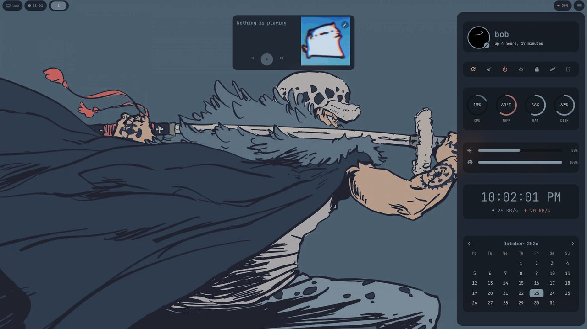
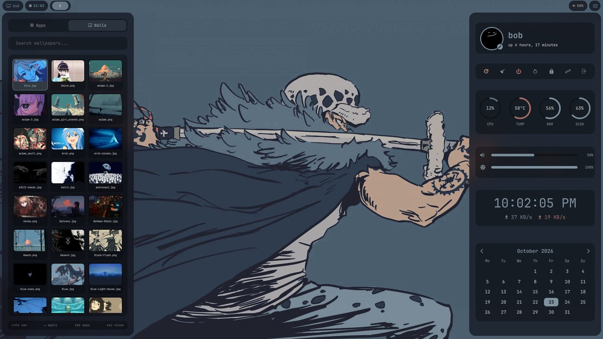
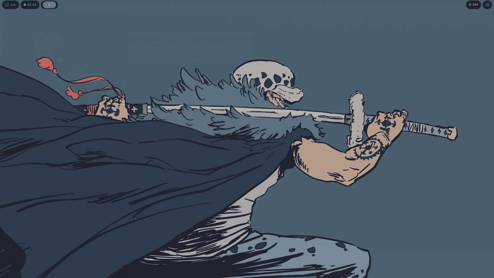
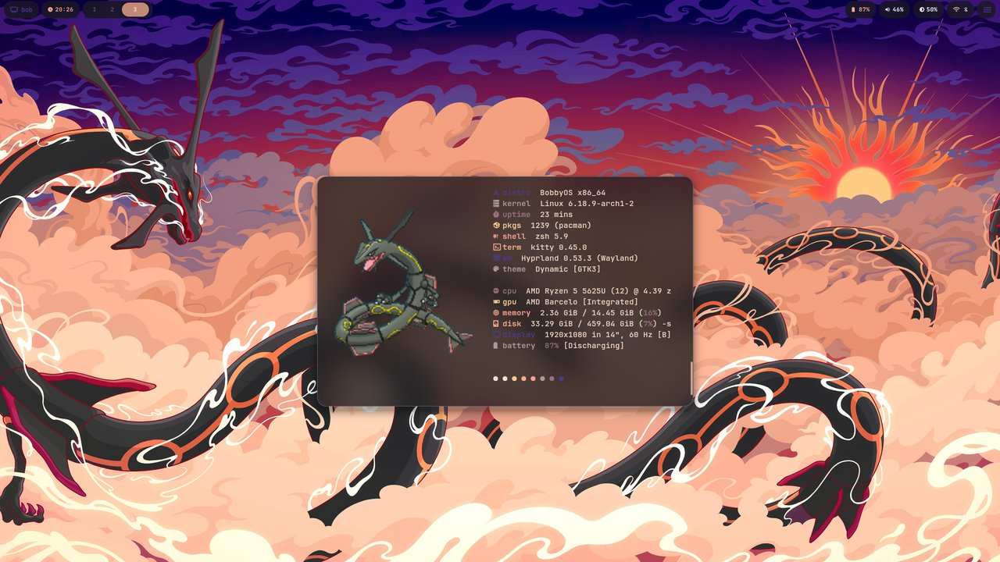
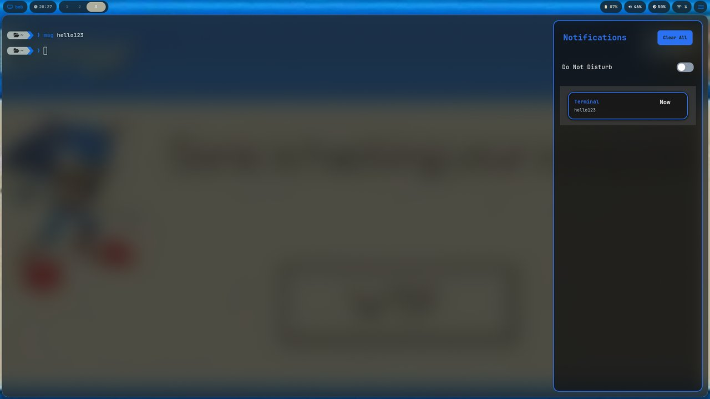
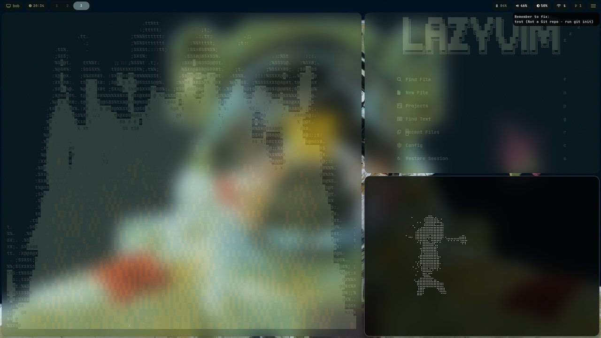
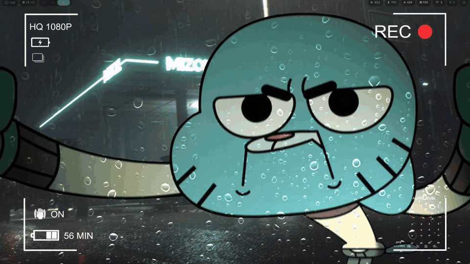

# bob-dotfiles

Hyprland dotfiles for Arch Linux, based on [Harman1307/dotfiles-Hyprland](https://github.com/Harman1307/dotfiles-Hyprland), with Quickshell widgets, Waybar and pywal colors that follow the wallpaper.

[](https://github.com/Zambrzyckii/bob-dotfiles/actions/workflows/ci.yml)




| Component | Tool |
|-----------|------|
| **WM** | Hyprland |
| **Terminal** | Kitty |
| **Widgets** | QuickShell |
| **App Launcher** | Quickshell |
| **Lockscreen** | Hyprlock |
| **Notifications** | SwayNC |
| **Wallpapers** | awww + pywal |
| **Bar** | Waybar |

## Screenshots









> Credits: [ViegPhunt](https://github.com/ViegPhunt), [binnewbs](https://github.com/binnewbs), [Mon4sm](https://github.com/Mon4sm), [Harman1307](https://github.com/Harman1307/dotfiles-Hyprland), [r/unixporn](https://www.reddit.com/r/unixporn/)

## Install

The installer is for Arch Linux and distributions based on it. It stops when `/etc/arch-release` is missing.

```bash
git clone https://github.com/Zambrzyckii/bob-dotfiles.git
cd bob-dotfiles
./install.sh
```

`install.sh` asks `first time? [y/n]`.

- `y` installs the packages with `sudo pacman`, installs `python-pywal` from the AUR with yay or paru, enables NetworkManager and Bluetooth, and then copies the configs.
- `n` only copies the configs.
- `./install.sh deps` and `./install.sh configs` run one of the two steps.

Before copying, the installer moves your existing `hypr`, `kitty`, `waybar`, `quickshell`, `swaync`, `scripts`, `wal`, `templates`, `fastfetch` and `cava` folders from `~/.config`, plus `~/.config/starship.toml`, `~/.zshrc` and `~/.Xresources`, into `~/.dotfiles-backup-<timestamp>`.

It also does the following.

- Copies the wallpapers to `~/wallpapers` without overwriting files that are already there.
- Copies the GIFs and the fastfetch logos to `~/bobby-dotfiles`.
- Writes `~/.local/bin/start-quickshell.sh`, which Hyprland runs at login.
- Replaces `/home/bob` with your home directory in the copied files.

When it finishes, log out and back in, then run `~/.config/scripts/random-wallpaper.sh` once. It picks a wallpaper and generates the pywal colors that Waybar and the widgets read.

A few things to check on a new machine.

- The shell config is for zsh. Kitty starts your login shell, so switch to zsh with `chsh -s /usr/bin/zsh` if it is not your shell yet.
- `.config/hypr/monitors.conf` lists the outputs of the machine it was written on. Adjust it for yours, for example with nwg-displays, which generated it.
- Without yay or paru the installer skips `python-pywal`, and the colors are never generated.

## Dependencies

`install.sh` installs these packages with pacman, plus `python-pywal` from the AUR.

| Role | Packages |
|---|---|
| Desktop | `hyprland`, `hyprlock`, `hypridle`, `quickshell`, `qt6-5compat`, `waybar`, `swaync`, `awww`, `kitty`, `thunar` |
| Theming | `python-pywal` (AUR), `imagemagick`, `ttf-jetbrains-mono-nerd`, `starship` |
| Audio and media | `wireplumber`, `alsa-utils`, `playerctl`, `mpd`, `mpc`, `mpd-mpris`, `rmpc`, `cava`, `gpu-screen-recorder` |
| System | `networkmanager`, `bluez`, `bluez-utils`, `brightnessctl`, `kdeconnect`, `pacman-contrib`, `xorg-xrdb` |
| Clipboard and screenshots | `wl-clipboard`, `cliphist`, `wofi`, `grim`, `slurp` |
| Script helpers | `jq`, `ripgrep`, `chafa` |
| Shell | `zsh`, `zsh-autosuggestions`, `zsh-syntax-highlighting`, `bat`, `eza`, `fastfetch` |
| Apps behind keybindings | `firefox`, `btop`, `asciiquarium`, `cmatrix`, `neovim`, `lazygit` |
| Other | `gnuplot` |

`pkglist.txt` and `aurlist.txt` are package snapshots from another machine. `install.sh` does not read them.

## Keybindings

`SUPER` is the modifier. These are the main bindings from `.config/hypr/hyprland.conf`.

| Keys | Action |
|---|---|
| `SUPER + Return` | Kitty |
| `SUPER + SHIFT + Return` | Floating Kitty |
| `SUPER + A` | App launcher |
| `SUPER + W` | Wallpaper picker |
| `SUPER + SHIFT + W` | Random wallpaper |
| `SUPER + D` | Dashboard |
| `SUPER + M` | Music panel |
| `SUPER + N` | Notification center |
| `SUPER + V` | Clipboard history |
| `SUPER + E` | Thunar |
| `SUPER + B` | Firefox |
| `SUPER + T` | btop |
| `SUPER + X` | Lock screen |
| `SUPER + Q` | Close the window |
| `SUPER + F` | Fullscreen |
| `SUPER + SPACE` | Toggle floating |
| `SUPER + 1` to `5` | Switch workspace |
| `SUPER + SHIFT + 1` to `5` | Move the window to a workspace |
| `SUPER + Print` | Screenshot to `~/screenshots` |
| `SUPER + SHIFT + Print` | Screenshot of a region, also copied to the clipboard |
| `SUPER + P` | Start recording to `~/screen-recordings`. The same key also toggles pseudotiling |
| `SUPER + SHIFT + P` | Stop recording |
| `Menu` | Look up the selected word in a dictionary |

## Structure

| Path | Contents |
|---|---|
| `.config/hypr/` | Hyprland, hyprlock and the monitor layout |
| `.config/quickshell/` | Launcher with the wallpaper picker, dashboard, music panel, Wi-Fi and Bluetooth panels |
| `.config/waybar/` | Bar config, style and status scripts |
| `.config/swaync/` | Notification center |
| `.config/scripts/` | Scripts behind the keybindings, such as the random wallpaper, clipboard and dictionary |
| `.config/kitty/`, `.config/starship.toml`, `.zshrc` | Terminal and shell |
| `.config/cava/`, `.config/fastfetch/`, `.config/rmpc/` | Audio visualizer, system info and MPD client |
| `.config/templates/` | Color templates in pywal format |
| `wallpapers/` | Wallpapers for the picker and the random wallpaper script |
| `Gif/`, `FastFetchLogos/` | GIFs for `GifScript.sh` and the fastfetch logos |
| `screenshots/` | Images for this README |
| `install.sh` | The installer |

## License

This repository has no license. Most files come from [Harman1307/dotfiles-Hyprland](https://github.com/Harman1307/dotfiles-Hyprland), which has no license either. The wallpapers, GIFs, avatars and fastfetch logos belong to their respective artists. Files from [cava](https://github.com/karlstav/cava) and [monasm-dots](https://github.com/Mon4sm/monasm-dots) are under the MIT license, and their notices are in [THIRD-PARTY-NOTICES.md](THIRD-PARTY-NOTICES.md).
